# Project Task Dependencies

**Project:** Jenkins-Based Policy Renewal Reminder System  
**Student:** Basil Shaikh | Roll No: 23102C0026 | Branch: CMPN C

---

## Purpose

This document explains the dependency relationships between project tasks. A dependency means that one task **must be complete before another can begin**. Understanding dependencies helps with planning and prevents wasted effort on tasks that are blocked.

---

## Critical Path

The **critical path** is the sequence of tasks where a delay in any single task will delay the entire project. For this project, the critical path is:

```
JDK Install → BL-06 (Maven Project) → BL-07 (Spring Boot Entry)
           → BL-08 (Properties) → BL-09 (Home Page)
           → BL-10 (Context Test) → BL-13 (Policy Entity)
           → BL-16 (Create Policy) → BL-17 (List) → BL-18 (Details)
           → BL-19 (Edit) → BL-20 (Mark Renewed) → BL-22 (Dashboard)
           → BL-26 (Git Init) → BL-27 (GitHub Push)
           → BL-29 (Jenkins Install) → BL-30 (Jenkinsfile)
           → BL-32 (Selenium Tests) → BL-33 (Selenium in Jenkins)
           → BL-34 (Dockerfile) → BL-35 (Docker Run)
           → BL-36 (Jenkins-Docker) → BL-37 (Ansible/Puppet)
           → BL-39 (End-to-End) → BL-40 (Submission)
```

Every task on this path must be completed on time for the project to finish by Week 15.

---

## Dependency Table

| Task ID | Task Name | Depends On | Blocking |
|---|---|---|---|
| BL-01 | Week 1 Documentation | None | BL-02 |
| BL-02 | Week 2 Planning Docs | BL-01 | BL-03 |
| BL-03 | Week 3 SRS + Architecture | BL-02 | BL-05 |
| BL-04 | Environment Readiness Check | None | BL-06 |
| BL-05 | Week 3 Completion Report | BL-03, BL-10 | BL-40 |
| BL-06 | Maven Project Structure | JDK Installed | BL-07 through BL-15 |
| BL-07 | Spring Boot Entry Point | BL-06 | BL-08, BL-09, BL-10 |
| BL-08 | Application Properties + H2 | BL-07 | BL-09, BL-13 |
| BL-09 | Home Page (Thymeleaf) | BL-07, BL-08 | — |
| BL-10 | Application Context Test | BL-07 | BL-05 |
| BL-11 | .gitignore | BL-06 | BL-26 |
| BL-12 | README | BL-06 | — |
| BL-13 | Policy JPA Entity | BL-08 | BL-14, BL-16 |
| BL-14 | Policy Repository | BL-13 | BL-15, BL-16 |
| BL-15 | Custom Repository Queries | BL-14 | BL-21, BL-22 |
| BL-16 | Create Policy Feature | BL-13, BL-14, BL-25 | BL-17 |
| BL-17 | View All Policies | BL-16 | BL-18, BL-23, BL-24 |
| BL-18 | View Policy Details | BL-17 | BL-19 |
| BL-19 | Edit Policy Feature | BL-18 | BL-20 |
| BL-20 | Mark as Renewed | BL-19 | BL-21, BL-22 |
| BL-21 | Upcoming Renewals View | BL-20, BL-15 | BL-22 |
| BL-22 | Dashboard Statistics | BL-20, BL-15 | MVP complete |
| BL-23 | Search Functionality | BL-17 | — |
| BL-24 | Status Filter | BL-17 | — |
| BL-25 | Form Validation | BL-07 | BL-16, BL-19 |
| BL-26 | Git Init | BL-11 | BL-27 |
| BL-27 | Push to GitHub | BL-26 | BL-28, BL-29 |
| BL-28 | Feature Branch Workflow | BL-27 | — |
| BL-29 | Jenkins Install | BL-27 | BL-30 |
| BL-30 | Jenkinsfile Pipeline | BL-29 | BL-31, BL-33 |
| BL-31 | Automated Deployment | BL-30 | BL-36 |
| BL-32 | Selenium Test Classes | BL-22 (MVP done) | BL-33 |
| BL-33 | Selenium in Jenkins | BL-30, BL-32 | — |
| BL-34 | Dockerfile | BL-31 | BL-35 |
| BL-35 | Docker Run | BL-34 | BL-36 |
| BL-36 | Jenkins-Docker CD | BL-30, BL-35 | BL-37 |
| BL-37 | Ansible/Puppet Playbook | BL-36 | BL-38, BL-39 |
| BL-38 | Health Check + Recovery | BL-37 | BL-39 |
| BL-39 | End-to-End Validation | BL-38 + all above | BL-40 |
| BL-40 | Final Documentation | BL-39 | Submission |

---

## Key Blocking Risks

| Risk | Impact | Mitigation |
|---|---|---|
| Java JDK not installed | All coding tasks blocked | Install JDK before Week 3 coding begins. See `setup-instructions.md`. |
| Week 3 skeleton does not compile | All feature tasks blocked | Fix compilation errors before proceeding. |
| MVP not complete by Week 6 | Selenium tests cannot be written; CI has nothing to test | Prioritise BL-16 through BL-22; defer BL-23, BL-24 if needed. |
| Jenkins installation fails | CI/CD pipeline cannot be set up | Consult faculty; consider alternative local Jenkins setup. |
| Docker not available | Containerisation tasks blocked | Weeks 11–12 depend on Docker; plan installation in advance. |

---

## Mermaid Dependency Diagram (Simplified — Critical Path)

```mermaid
graph LR
    JDK[JDK Installed] --> BL06[BL-06 Maven Project]
    BL06 --> BL07[BL-07 Spring Boot]
    BL07 --> BL08[BL-08 Properties]
    BL08 --> BL13[BL-13 Policy Entity]
    BL13 --> BL14[BL-14 Repository]
    BL14 --> BL16[BL-16 Create Policy]
    BL16 --> BL17[BL-17 List View]
    BL17 --> BL18[BL-18 Detail View]
    BL18 --> BL19[BL-19 Edit Policy]
    BL19 --> BL20[BL-20 Mark Renewed]
    BL20 --> BL22[BL-22 Dashboard]
    BL22 --> MVP[MVP Complete]
    MVP --> BL26[BL-26 Git Init]
    BL26 --> BL27[BL-27 GitHub Push]
    BL27 --> BL29[BL-29 Jenkins]
    BL29 --> BL30[BL-30 Jenkinsfile]
    MVP --> BL32[BL-32 Selenium Tests]
    BL30 --> BL36[BL-36 Jenkins-Docker]
    BL32 --> BL33[BL-33 Selenium in CI]
    BL36 --> BL37[BL-37 Ansible/Puppet]
    BL37 --> BL39[BL-39 End-to-End]
    BL39 --> BL40[BL-40 Submission]
```


